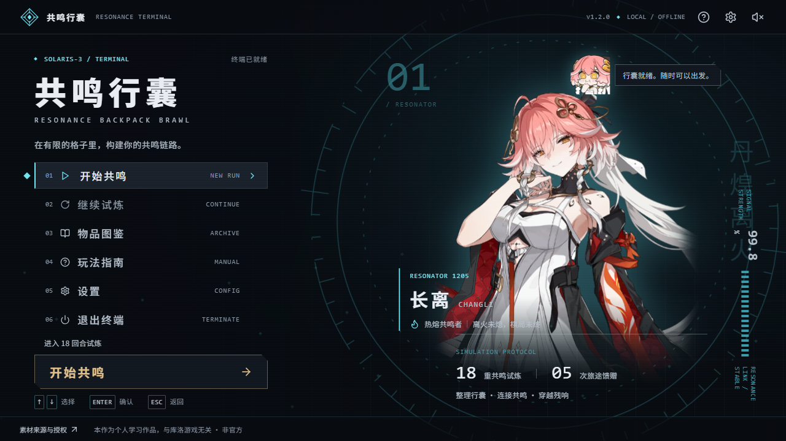

# 鸣潮 · 共鸣行囊

一款鸣潮主题的离线单人背包构筑游戏。用有限的格子摆放装备，构筑相邻协同，挑战 18 回合自动战斗。

发行包：[Releases](https://github.com/s3561272388-pixel/Wuthering-Waves-Backpack-Brawl/releases)。源码构建说明见下文。



## v1.2.0 · 共鸣终端

新增独立启动界面：长离立绘、频谱环、六项菜单、存档摘要、只读图鉴、玩法说明、设置与素材署名。按任意键可跳过开场；方向键选择菜单，Enter 确认，Esc 关闭弹窗。新建试炼前会确认是否覆盖旧记录，损坏存档会保留备份。可在设置中减少动态效果，也会尊重系统的减少动态效果设置。

Windows 64 位用户运行 `Resonance-Backpack-Setup-1.2.0-x64.exe`，按提示选择目录安装，再从桌面或开始菜单打开“共鸣行囊”。窗口较小时可按 F11 切换全屏；建议可用区域至少 1280×720。安装包尚未进行代码签名。卸载保留游戏存档。

桌面版和浏览器版的存档各自独立，本版不会自动迁移浏览器记录。本次仅新增启动终端和桌面包装，战斗规则、关卡难度、奖励和原游戏样式保持 v1.1 不变。验收范围见 `reports/启动终端验收.md`。

## 直接游玩

下载 Release 中的离线网页版，完整解压后双击 **开始游戏.html**，使用 Chrome 或 Edge 打开即可。无需安装、无需启动服务器，图片和程序均已包含在本地。源码仓库不包含生成后的 HTML，下载源码后请先按照下文构建。

如果拿到的是压缩包，请**完整解压**，保持 `开始游戏.html` 与 `assets` 文件夹在同一目录，不要只拖出一个 HTML 文件。

选择长离、炽霞、安可或维里奈开始试炼。浏览器会自动保存当前局；文件版与 localhost 版使用各自的存档。清除浏览器数据、移动游戏目录或使用隐私模式可能使存档不可继续。

## 怎么玩

- 从补给站拖动物品到背包，或先点击物品，再点击目标格子。成功放入才扣贝币。
- 选中物品后按 **R** 或右键旋转。正交相邻触发协同，跨背包页无效。
- **Ctrl+Z** 撤销最近 20 次摆放、买卖和扩容。刷新、升阶与跨回合会清空撤销记录。
- 把背包物品拖到出售区回收贝币，也可以选中后点击出售按钮。
- 三件同名同星物品可确认升阶，保留最早那件的位置。设置中可主动开启自动升阶。
- **D** 刷新商店，最多锁定三件补给。**空格** 开战；支持 1× / 2× / 4× 和跳过。
- 第 3 回合开放付费扩容，第 5 / 11 回合解锁第二 / 第三背包页。
- 完成第 **3 / 6 / 9 / 12 / 15** 关且仍有命值时，进入一次无战斗的奖励关，武器 / 贝币 / 属性三选一，不替代原有 18 关。
- 武器奖励：第 3 关为稀有，第 6 / 9 关为史诗，第 12 / 15 关为传说；优先本职业，缺少对应武器时提供其他职业的同阶武器，奖励武器全角色可装备。先放入“奖励寄存”，拖入背包后生效；背包满时不会丢失。
- 贝币奖励依次为 **12 / 15 / 18 / 21 / 24**；属性奖励每次增加 **15% 最大生命、8% 攻击伤害**，本局永久叠加，新局重置。奖励领取不可撤销或重抽。
- 保留至少一命撑过第 18 回合即通关。

角色、武器和声骸使用鸣潮主题美术，效果、职业特性、稀有度与数值是本游戏的独立改编。角色表现采用 2D 表情贴图与界面动效。设置中提供音量、循环环境音、动效开关、色觉辅助和自动升阶开关。

## 内容

四个角色 / 四种构筑职业、40 件物品、18 个战斗关卡、5 次奖励关、三页背包、商店、旋转、相邻协同、三合一升阶、冻结、出售、撤销、扩容、自动战斗、战报导出、局末统计、图鉴搜索、设置、本地存档。

v1.1 难度更新下调各关敌人生命和攻击伤害 20%，第 4 / 5 / 6 / 7 / 9 关下调 30%。旧存档兼容，从下一个尚未完成的奖励节点开始生效，不补领历史奖励。详细对照见 `reports/难度测试与奖励关更新.md`。

`reports/交付与验收.md` 记录实际测试范围、数值结果和已知限制。`ATTRIBUTIONS.md`、`assets/manifest.json` 和 `assets/LICENSES.csv` 记录素材来源。`docs/` 保留原策划作为参考；实际执行规则以本版本数据和引擎为准。

## 继续开发

安装 Node.js 后，在项目目录运行：

```sh
npm install
npm run dev
```

打开终端给出的本地地址，默认 `http://127.0.0.1:5173`。开发服务器会在源码、数据或素材变化后重新构建并刷新页面。`npm run dev:vite` 保留常规 Vite 开发入口；默认入口兼容当前 Windows 沙箱的目录读取限制。

```sh
npm run build       # 生成双击版 HTML 及 dist 静态目录
npm run desktop     # 本地打开 Electron 窗口（先 build）
npm run release     # 在 Windows 构建 x64 NSIS 安装包至 release/
npm test            # 规则与交互状态测试
node tools/difficulty-test.mjs --runs 100 --seed 500003 # 每角色 100 局，含全部奖励与真实商店操作
npm run qa          # 数据、确定性、性能、当前难度证据指纹、引擎纯净性检查
node tools/diff-test.mjs --evals reports/evals --report reports/game-diff.md
```

浏览器回归可安装 Playwright 与 Chrome 后运行 `node tests/browser.cjs`、`node tests/edge-campaign.cjs`、`node tests/rewards-browser.cjs`。最后一项用四个角色分别通过真实界面完成 18 关并击败关底，包含奖励刷新存档与小屏检查。

`tools/run-balance.mjs`、`tools/calibrate.mjs` 及 `balance-*.json` 保留为原版参考工具与历史记录；该代理没有奖励系统，不能代表新版难度，也不应用它把敌人自动调回原版目标区间。新版以 `tools/difficulty-test.mjs` 的真实游戏状态流程为准；四角色概率仍有差异，自动代理数据不等同真人通关率。

`packages/engine/battle.mjs` 是纯逻辑战斗引擎，`game.mjs` 管理购买、摆放、合成、经济和回合状态；`apps/web/` 是 React 界面。构建由 esbuild 完成，运行时不依赖网络、外部服务或 Canvas。

新增启动页验证可运行 `node tests/terminal-browser.cjs`；Windows 桌面验证运行 `node tests/desktop.cjs --packaged`（先构建安装包）。两者需要 Playwright，前者还需要 Chrome。桌面检查使用独立测试存档。

`.github/workflows/release.yml` 提供 Windows 自动构建与 Release 发布流程，目标为用户指定的 `s3561272388-pixel/Wuthering-Waves-Backpack-Brawl`。可在该仓库 Actions 页面手动运行；推送相关文件到默认分支也会触发。流程不会覆盖同版本的既有 Release，运行状态与下载文件以仓库的 Actions 和 Releases 页面为准。

战报 CLI：

```sh
npm run sim:dump -- --seed 42 --round 1 --a reports/fixtures/a.json --b reports/fixtures/b.json --out reports/cli-eval.json
# 安装 pnpm 后也可以：pnpm -F engine sim:dump --seed 42 --round 1 --a <绝对路径> --b <绝对路径> --out <绝对路径>
```

## 权利说明

这是非官方、非商业同人玩法原型。原作名称、角色及游戏美术归库洛游戏及相应作者所有。角色来源页面标示 CC BY-NC-SA 4.0，已保留作者与链接；武器和声骸仓库的公开访问不意味着商业授权。发布或商业化前请核实所有素材的使用许可。
